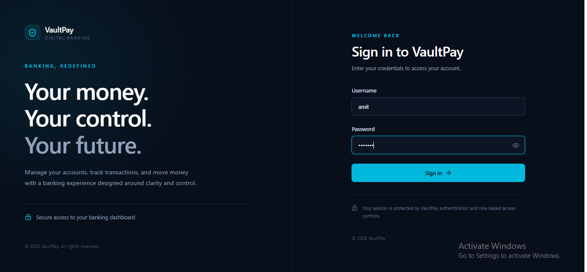
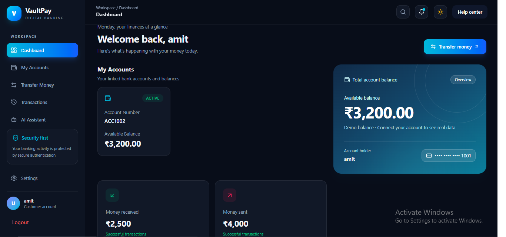
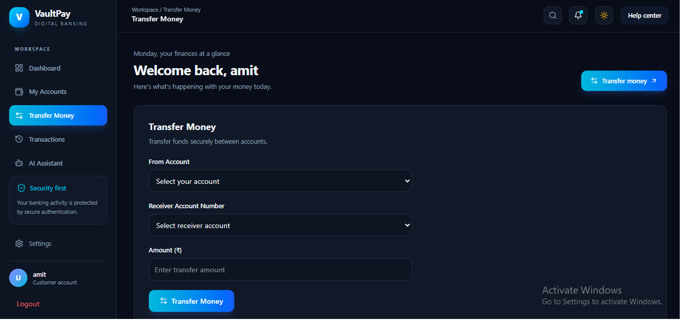
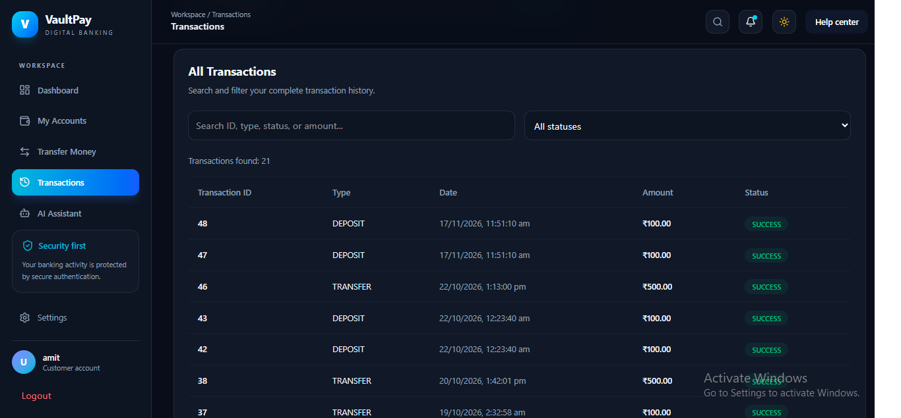
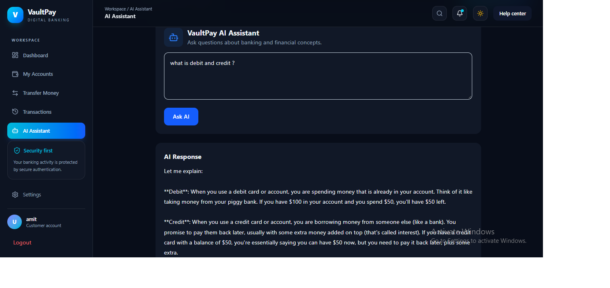

# VaultPay – Digital Banking & Ledger System

VaultPay is a full-stack digital banking application built using **Java, Spring Boot, React, and MySQL**. It provides secure banking operations, account management, fund transfers, transaction history, ledger management, and an AI-powered assistant.

The application follows a layered backend architecture and provides a modern, responsive frontend for managing banking activities.

## Features

### Authentication & Security
- User registration and login.
- JWT-based authentication.
- Role-based authorization for customers and administrators.
- Protected REST APIs using Spring Security.

### Account Management
- Create and retrieve bank accounts.
- View account information and balances.
- Retrieve eligible receiver accounts.

### Fund Transfers
- Transfer money between accounts.
- Validate account ownership and account status.
- Check available balance before transfers.
- Manage concurrent transfers using database locking.
- Maintain transaction consistency and rollback on failure.

### Transaction Management
- View transaction history.
- Track deposits, withdrawals, and transfers.
- Display transaction details and statuses.
- Dashboard statistics for money received and sent.

### Double-Entry Ledger
- Maintain debit and credit ledger entries.
- Record financial movements for transfers.
- Preserve transaction consistency.

### AI Assistant
- AI-powered banking assistant integration.
- Spring AI with Ollama.
- Configured to use the Llama 3.2 model.

### Additional Features
- Centralized exception handling.
- Swagger/OpenAPI documentation.
- Spring Boot Actuator monitoring.
- Unit and integration testing.


## Application Screenshots

### Login Page


### Dashboard


### Transfer Money


### Transaction History


### AI Assistant



## Technology Stack

| Technology | Purpose |
|---|---|
| Java 17 | Backend programming |
| Spring Boot | Backend framework |
| Spring Security | Authentication and authorization |
| Spring Data JPA / Hibernate | ORM and database operations |
| MySQL 8 | Relational database |
| JWT | Token-based authentication |
| Maven | Build and dependency management |
| React | Frontend development |
| Vite | Frontend build tool |
| Tailwind CSS | Frontend styling |
| Axios | API communication |
| Spring AI | AI integration |
| Ollama | Local AI model runtime |
| JUnit / Mockito | Automated testing |
| Swagger / OpenAPI | API documentation |

## Application Architecture

VaultPay follows a layered backend architecture with a React frontend.

```text
                 React Frontend
                       |
                    Axios
                       |
                 REST API Layer
                       |
              Spring Boot Backend
                       |
        +--------------+--------------+
        |              |              |
    Controller      Service       Security
        |              |              |
        +--------------+--------------+
                       |
                 Repository Layer
                       |
                    MySQL
                       |
              Transaction Ledger

             AI Assistant Integration
                 Spring AI + Ollama
```

## Project Structure

```text
VaultPay/
|
|-- frontend/
|   |-- public/
|   |-- src/
|   |   |-- assets/
|   |   |-- pages/
|   |   |-- services/
|   |   |-- App.jsx
|   |   |-- Dashboard.jsx
|   |   |-- api.js
|   |   |-- main.jsx
|   |
|   |-- package.json
|   |-- vite.config.js
|
|-- src/
|   |-- main/
|   |   |-- java/com/vaultpay/
|   |   |-- resources/
|   |
|   |-- test/
|
|-- pom.xml
|-- README.md
```

## Prerequisites

Install the following before running the application:

- Java 17
- MySQL 8.x
- Node.js and npm
- Git
- Ollama (for the AI Assistant)
- Maven or the included Maven Wrapper

## Running the Application Locally

### 1. Clone the Repository

```bash
git clone https://github.com/SiddheshGaikwad/VaultPay.git
cd VaultPay
```

### 2. Configure MySQL

Make sure your MySQL server is running.

The application uses the following database configuration:

```properties
spring.datasource.url=jdbc:mysql://localhost:3306/vaultpay?createDatabaseIfNotExist=true
spring.datasource.username=root
spring.datasource.password=${DB_PASSWORD}
```

Set the required environment variables.

**Windows CMD:**

```cmd
set DB_PASSWORD=your_mysql_password
set VAULTPAY_JWT_SECRET=your_secure_jwt_secret
```

Use your own strong JWT secret. Never commit credentials to GitHub.

### 3. Start the Backend

From the root `VaultPay` directory:

```cmd
mvnw.cmd spring-boot:run
```

The backend runs at:

`http://localhost:8080`

### 4. Start the Frontend

Open a second terminal and navigate to the frontend directory:

```cmd
cd frontend
npm install
npm run dev
```

Vite will display the local frontend URL, usually:

`http://localhost:5173`

### 5. Run the AI Assistant

Install and start Ollama, then pull the configured model:

```bash
ollama pull llama3.2
ollama serve
```

Keep Ollama running while using the AI Assistant.

## API Documentation & Monitoring

Once the backend is running:

| Resource | URL |
|---|---|
| Swagger UI | http://localhost:8080/swagger-ui/index.html |
| Actuator Health | http://localhost:8080/actuator/health |
| Actuator Info | http://localhost:8080/actuator/info |

## Testing

Run the backend test suite from the root project directory:

```cmd
mvnw.cmd test
```

The project currently passes **62 automated tests with zero failures and zero errors**.

Tests include unit tests and integration tests covering transfer operations, concurrency, and rollback behavior.

## Security Notes

- Never commit database passwords or JWT secrets.
- Use environment variables for sensitive configuration.
- Use strong, unique secrets.
- Validate account ownership and transaction authorization.
- Review security settings before production deployment.

## Future Enhancements

- Docker-based deployment.
- Enhanced analytics and reporting.
- Additional security and integration testing.
- Production deployment and monitoring improvements.

## Author

**Siddhesh Gaikwad**

GitHub: https://github.com/SiddheshGaikwad

Project Repository: https://github.com/SiddheshGaikwad/VaultPay
